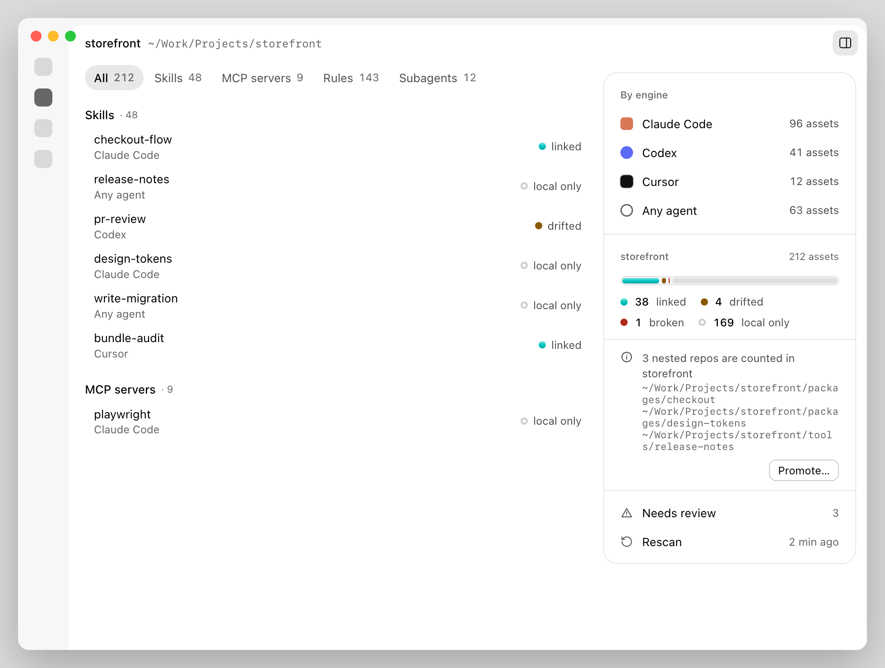
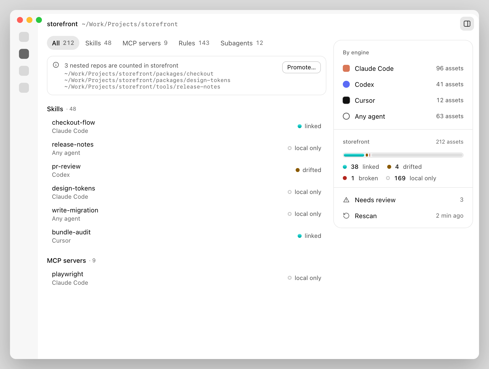
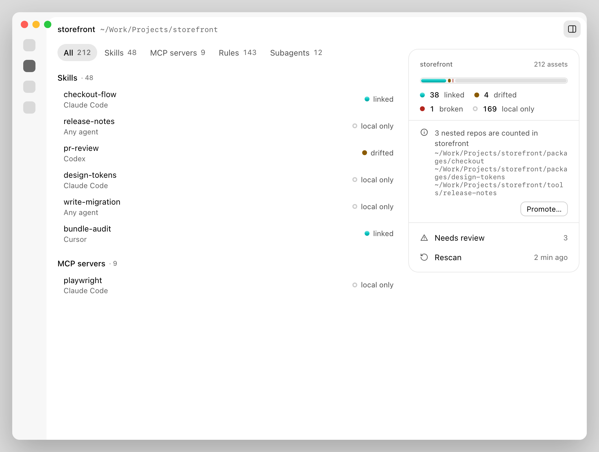

# Round 29: the repository's overview card, its layout and its words

Task 4 of [the repository-view parity plan](2026-11-27-repo-view-parity.md). You ruled in round 28 that the overview card replaces a repository's summary strip and its "By engine" band, that its first section is the repository's asset counts per engine, and that nothing folds. This round picks where things sit in the card and what the new lines say. Your picks fill in Tasks 5 and 6 before they start.

The full mock, every option in four states (All tab, Skills tab, a repository macOS has blocked, the popover), light and dark: [2026-11-27-repo-overview-options.html](../design-ref-prototypes/2026-11-27-repo-overview-options.html). The words and the code behind each one: [the naming brief](2026-11-27-repo-view-parity-naming-brief.md). The sample repository is made up.

:::question
Which layout should a repository's overview card use?

All three are the card at its true 280px, docked beside a 560px list. They differ in where the nested repositories go and whether the engine counts stay. On a kind tab every option drops the engine rows and keeps the nested-repository line.

- [ ] A · Nested repos inside the card —  By engine, then the repository's link state, then the nested repositories with their paths and Promote…, then the actions. Everything about the folder lives in one place.
- [ ] B · Nested repos above the list —  The card keeps Global's sections exactly; the nested repositories become a row at the head of the list, beside the rows they change. Always on screen, even with the card hidden.
- [ ] C · No engine section —  The shortest card, with the nested section as in A. Drops the engine counts, which your round 28 q2 answer kept; drawn only so you can see what they cost.

Recommended: A · Nested repos inside the card
:::

:::question
How should the engine rows give their figures?

Where: the card's first section on a repository, All tab.

Before: the band's "By engine" rows, "Claude Code 96 assets".

After: depends on the choice below.

- [ ] Head "By engine", no caption, rows read "96 assets" or "1 asset" — the approved words, as the band prints them today
- [ ] Head "By engine", caption "assets", rows read "96" — Global's pattern, the unit in the caption and bare figures in the rows
- [ ] Head "Engines", no caption, rows read "96 assets" — Global's head word for the same slot

Recommended: Head "By engine", no caption, rows read "96 assets" or "1 asset"
:::

:::question
What heads the repository's own section, the one with the link-state legend?

Where: the card's store section on a repository. On Global it reads "The global store".

Before: the strip's big figure and "assets in storefront".

After: depends on the choice below.

- [ ] The folder's name, "storefront" — names the scope in one word, as Global's head does
- [ ] "This repository" — the same on every repository, so it never truncates
- [ ] "In storefront" — reads as a phrase with the caption beside it

Recommended: The folder's name, "storefront"
:::

:::question
On a kind tab, what should the section's caption say?

Where: right of the section's head, on the Skills, MCP servers, Rules and Subagents tabs.

Before: the strip read "48 skills in storefront".

After: depends on the choice below.

- [ ] The kind's own noun: "48 skills", "9 MCP servers", "1 rule" — the figure already narrows to the tab, and the words say so
- [ ] Always "assets": "48 assets" — the same word on every tab, but it hides that the figure changed

Recommended: The kind's own noun: "48 skills", "9 MCP servers", "1 rule"
:::

:::question
What should the nested-repository line say now that it is not under the band?

Where: option A and C, the card's own section above the actions; option B, the row at the head of the list.

Before: "3 nested repos count towards this row"

After: depends on the choice below.

- [ ] "3 nested repos are counted in storefront" and "1 nested repo is counted in storefront" — says what happens and names the folder, since there is no row any more
- [ ] "Includes 3 nested repos" — shorter, but leaves out what is included
- [ ] "3 nested repos count towards storefront" — the nearest to today's words

Recommended: "3 nested repos are counted in storefront" and "1 nested repo is counted in storefront"
:::

:::question
Should a single asset read "1 asset"?

Where: every figure `storeAssetsLabel` prints. On a repository, the engine rows and the All tab's caption; on Global, the All engines row and the store caption.

Before: "1 assets"

After: "1 asset"

- [ ] Yes, "1 asset" everywhere — fixes the line known-debt.md recorded as "1 assets in rkarthik"
- [ ] Leave it — no change to Global

Recommended: Yes, "1 asset" everywhere
:::

## Answers (Karthik, 2026-11-27, in Plannotator)

All six took the recommendation: **A** (nested repos inside the card); engine rows headed "By engine", no caption, rows read "96 assets" / "1 asset"; the repository section is headed by the folder's name; on a kind tab the caption uses the kind's own noun ("48 skills", "9 MCP servers", "1 rule"); "3 nested repos are counted in storefront" / "1 nested repo is counted in storefront"; "1 asset" everywhere, Global included.
